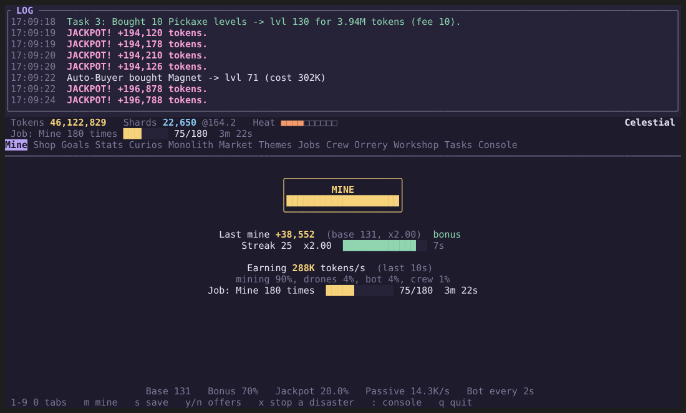
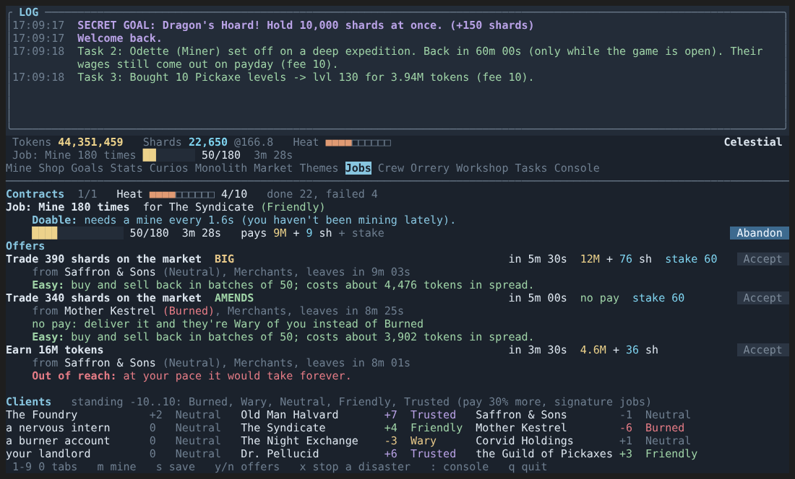
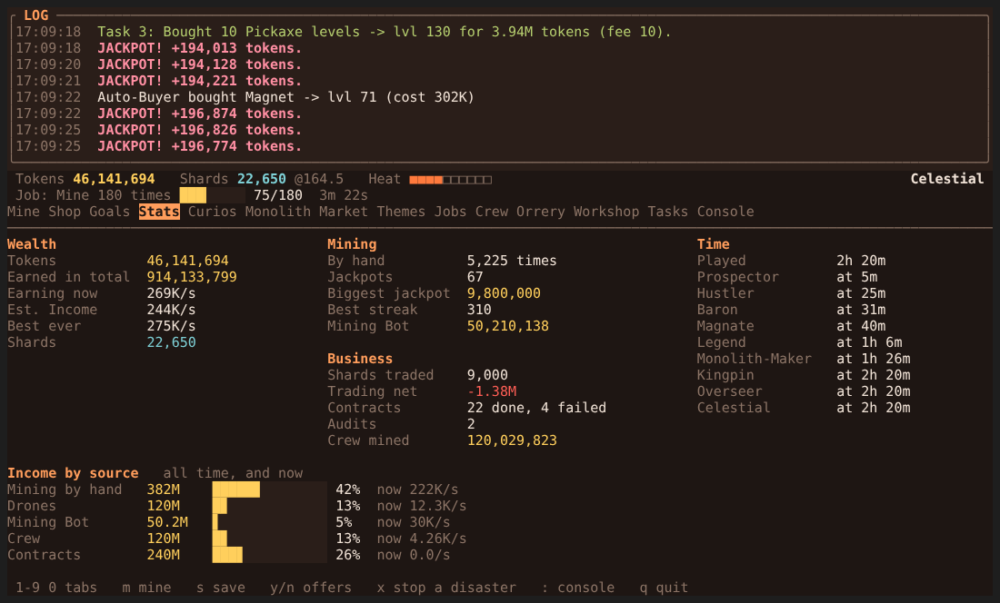
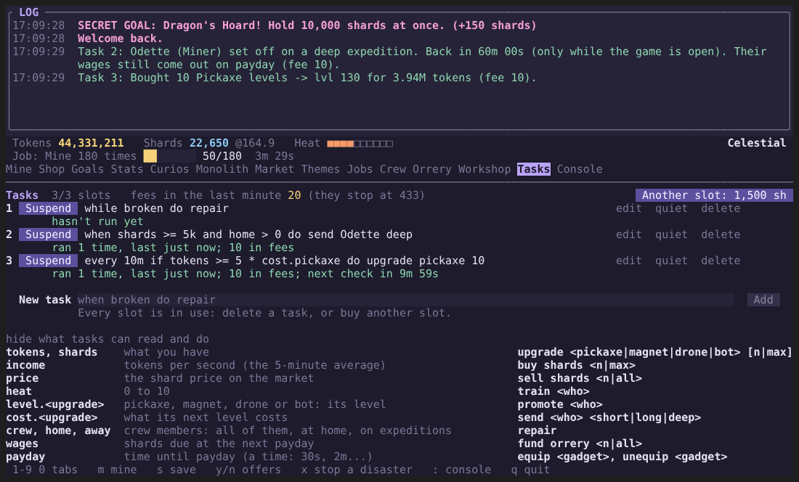
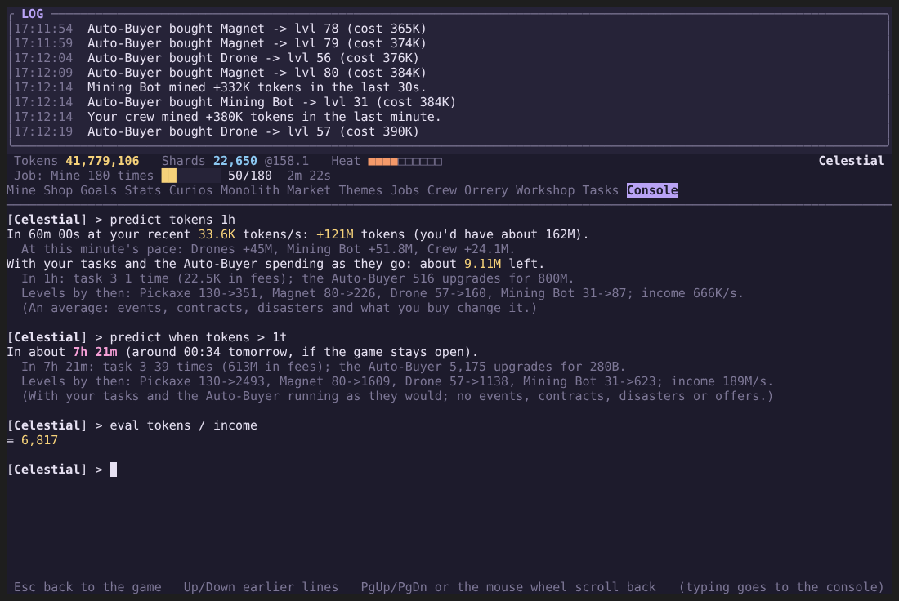
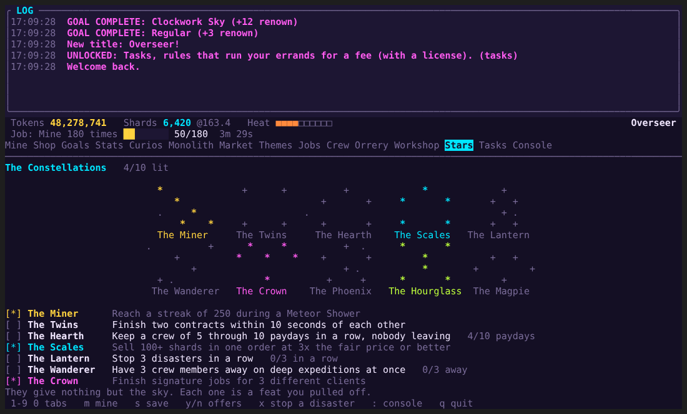
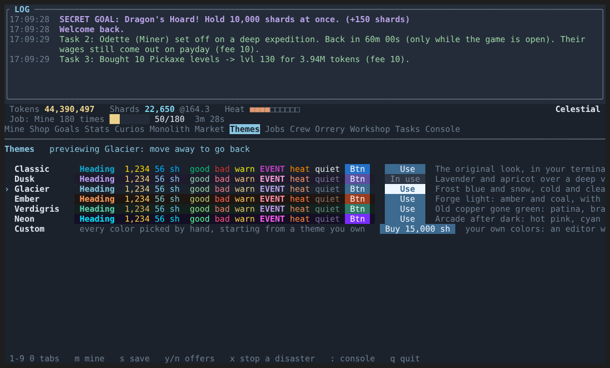

# TokenRush

An idle mining and clicker game with background automation, full screen in the terminal: a pinned
log, tabs, a clickable MINE button, and a **Console** tab where every command can be typed.

Start by mining by hand, then buy Drones and a Mining Bot that earn while you're away. Titles
open the rest: a shard market, timed contracts from clients who remember you, a crew to hire
and send on expeditions, gadgets, disasters to fend off, constellations to light, and a small
automation language for the late game. Six color themes, or your own.

| | |
|---|---|
|  |  |
| **Jobs:** timed contracts, with a tip on how hard each looks at your pace | **Stats:** records, where your income comes from, and what you're earning now |
|  |  |
| **Tasks:** one-line rules (`when shards >= 5k do send anyone deep`) | **Console:** every command typed, plus `predict` and `eval` |
|  |  |
| **Stars:** feats that light up a sky map | **Themes:** hover one and the whole screen previews it |

C++20, with [FTXUI](https://github.com/ArthurSonzogni/FTXUI) 7.0.3. (There used to be a separate
command-line edition, `tokenrush-cli`. It's gone: its commands live on in the Console tab.)

## Build

Needs Python 3.10+ and a C++20 compiler (g++ or clang++) on Windows (MSYS2 MinGW), Linux and macOS.
First fetch FTXUI into `dependencies/` (downloads 7.0.3, makes the amalgamated `ftxui.hpp` and
`ftxui.cpp`, compiles `ftxui.o`):

    python tools/fetch_ftxui.py

Then, into `target/debug/` (the programs are `tokenrush-tui` and `sim`, with `.exe` on Windows):

    python build.py              # tokenrush-tui
    python build.py --sim        # the balance simulator (add --tui to build both)
    python build.py --rebuild    # ignore what's already built and compile everything
    python build.py -j 4         # 4 files at a time (default: one per CPU core)

`CXX=clang++ python build.py` picks another compiler.

Builds are incremental: each `.cpp` is compiled to its own `.o` in `target/debug/obj/`, with a
hash of the `.cpp`, every header it includes, and the compiler flags. Only files whose hash
changed are compiled again (edit one `.cpp`, one file compiles; edit a header, only the files
that include it do), and the program is only relinked when one of its objects changed. Files compile
in parallel, one per CPU core, the slowest first (a full build here: 30 s on 4 cores, against
150 s one at a time). Times go to
`target/debug/build-times.log`. (`build.ps1` is the older PowerShell version of the same thing.)

Linux / macOS can also use `make` (`make sim` for the simulator; output in `build/` and the
programs next to the Makefile). It builds `dependencies/ftxui.cpp` itself, so
`python tools/fetch_ftxui.py --no-compile` is enough.

## Run

    python play.py [options]     # recommended: builds if needed, and keeps the game up to date
    tokenrush-tui [--profile <name>] [--data-dir <folder>] [--save-dir <folder>] [--no-color] [--no-update-check]

**Updates.** Started through `play.py` (from a git clone), the game checks GitHub for new
commits in the background, when it starts and again every 5 to 10 minutes while you play.
Updates come in two kinds, marked in their commit messages: **gameplay** ones (`Update: gameplay`:
they change how the game plays) are treated like a security fix: the moment one is found, the
game saves and shuts down, and `play.py` installs it and starts the new version; **minor** ones (looks, wording,
tools, and anything unmarked) are a quiet line on the profile screen and in the log, and `u`
installs them whenever you like. In the Console, `update` (or `u`)
checks right away and updates if there's something new, and `check` only looks: whether you're
up to date, `check list` (when and what), `check titles`, `check dates`, `check count`, `check
show <n>` (a whole commit message), `check files` and `check current`; and earlier versions with
`check history`, `check show ~3` and `check find <words>`. On a yes the
game saves and quits, and `play.py` clears the screen, lists what's new, runs `git pull --ff-only`
and `build.py` quietly behind a progress bar, then starts the new launcher and the game. If the
pull or the build fails (say, your own edits clash with the update), it shows git's or g++'s
reason and starts the version you had. Started any other way, or with
`--no-update-check`, the game never looks. (The game can't do it alone: Windows won't
overwrite a running `.exe`.)

It starts with a **profile picker**: choose a profile, make a new one, or delete one (no
passwords, for now). Each profile is a folder with its own save:

    Windows:      %LOCALAPPDATA%\TokenRush\profiles\<name>\tokenrush.save
    Linux/macOS:  ~/.local/share/tokenrush/profiles/<name>/tokenrush.save

- `--profile <name>` skips the picker (and creates the profile if it's new).
- `--data-dir <folder>` keeps profiles somewhere else.
- `--save-dir <folder>` ignores profiles and plays straight from that folder.
- `--no-color` (or the `NO_COLOR` environment variable) turns colors off.
- `--no-update-check` skips the update check under `play.py`.

A save from before profiles (the `.save` folder next to the exe) can be imported from the
picker. The original is kept, renamed to `tokenrush.save.imported`. Profiles can be renamed from
the picker (its rename button).

**TUI keys:** click anything, or `1`-`9` and `0` to switch tabs (`[` and `]` step to the
previous and next one, and so do Ctrl+PgUp/PgDn and Alt+Left/Right, even while typing in the
Console) (Mine, Shop, Goals, Stats, then
Curios, Monolith, Market, Themes, Jobs, Crew, Orrery, Workshop, Stars, Tasks in unlock order; locked ones
aren't shown), `m` to mine, `s` to save, `y`/`n` to answer an offer, `x` to stop a disaster,
`:` for the Console, `p` to switch profile, `q` to quit (`p` and `q` ask first: press the same
key again; Ctrl+C quits right away, and saves). Tab, the arrows and Enter move around and press buttons. While a text box
has the keyboard (the Console, the Market's amount box), keys type into it and Esc steps out.
Risky buttons (Fire, Abandon, Delete, and Buy when it would buy at a steep price) need a
second click within 3 seconds.

**The Console tab** is where everything can be typed: every command, with its menus and
questions, in color, with Up/Down for earlier lines. PgUp/PgDn and the mouse wheel scroll back
through its output (End, or just typing, comes back down). A few things only exist there:
prompt styles (and `prompt color #ff8800`: your prompt in a color of yours, 12,000 shards once),
`wipe`, `log` with filters, `predict`, and the `help` pages.

**Quieter log:** `silence market` (or bot, crew, scouts, autobuyer, tasks, jackpots, heat,
offers, events, or `all`) keeps that kind of routine message out of the log pane; `log` still
has them, and `unsilence` brings them back. Disasters, offers, audits and job results always show.

**Typing:** the Console suggests the rest of what you're typing, greyed out: an earlier line
that starts the same way, or else the command, subcommand, gadget, client or task-language
word you're in the middle of. Tab (or Right at the end of the line) takes it. Up/Down walk back
through earlier lines, skipping repeats.

**Commands:** type `help` in the Console, and `help <command>` (aliases work: `help ct`) for a full page on one
command, with examples. `logout` goes back to the profile list, `cls`/`clear` clears the
screen, and Enter on an empty line does nothing. `shop 1 10` buys 10 Pickaxe levels without the
menu, `curios 3` buys curio 3, `buy`/`sell` take amounts like `2k`, and `log 50 bad` shows the
last 50 bad-news messages.

**Your own aliases:** `alias <command...> <name>` gives a command a short name: `alias predict
tokens 1h pt` makes `pt` run `predict tokens 1h`, and anything typed after an alias goes on the end
(with `alias predict tokens pt`, `pt 2h` runs `predict tokens 2h`). `alias` lists yours, `rmalias
<name>` removes one, and `help <alias>` says what it runs. They're saved with the profile (up to 50)
and survive a wipe; a command's own name always wins, and an alias can't run another alias.

**Predictions:** `predict <what> <time|count>` multiplies your current rates out: `predict tokens 1h`
(your income over an hour, by source), `predict jackpots 1000` (how many in 1000 mines, give or
take, and what they pay; `predict jackpots 10min` does it at your mining pace), `predict shards
2h` (Scouts minus wages), `predict heat 30min`, `predict paydays 1h`, `predict events 1h`, and
`predict magnet 50` (the cost of 50 levels, the income they add, and how long they take to pay
off). `predict` alone lists them. The other way round, `predict when <condition>` says how long
until something is true, and at what time: `predict when tokens > 20t`, `predict when shards > 100k`,
`predict when tokens > 5 * cost.pickaxe`. Conditions are written like a task's (plus `earned`,
`mines` and `jackpots`); the random price is refused. With tasks or the Auto-Buyer on, `predict
tokens`, `predict shards` and `predict when` play the game forward a second at a time with them
running (fees, what they buy, and what that does to your income) and say what they did.

**Eval:** `eval <expression>` works anything out from your numbers right now, in the same
language: `eval tokens / income`, `eval cost.pickaxe * 10`, `eval payday + 5m` (a time), `eval
shards >= 5k and heat < 3` (true or false).

**Themes** open with the Market (they're bought with shards), on their own **Themes** tab next
to it. `theme` lists them, each with a preview line in its own colors. Classic (the default: the
original colors, softened), Dusk and Terminal (your terminal's own colors) are free; Glacier,
Ember, Verdigris and Neon are bought with shards; on the Themes tab, hovering a theme previews
the whole screen in it. A theme belongs to the profile. Every theme but Terminal is 24-bit color
(`ESC[38;2;r;g;bm`), with its own background in the TUI.

**The custom theme** (15,000 shards, once) is yours to color by hand. It starts as a copy of the
theme you're using; then the Themes tab's editor lets you change each of its 17 colors (by R/G/B
steps or a hex code), shows how readable the text is, and draws a fixed sample scene that uses
every color, while the whole screen shows your colors as you go. In the Console:
`theme custom`, `theme custom accent #ff8800`, `theme custom from neon`.

## What's in the game

A new game starts with just mining, the shop and the goals. Goals earn renown, renown earns
titles, and titles open the rest of the game, one piece at a time:

| Title | Renown | Opens |
|---|---|---|
| Prospector | 4 | Curios |
| Hustler | 10 | the Monolith |
| Baron | 18 | the Market |
| Magnate | 28 | Contracts |
| Legend | 40 | the Crew (and, from then on, disasters) |
| Monolith-Maker | 55 | the Orrery |
| Kingpin | 62 | the Workshop |
| Overseer | 72 | Tasks |
| Celestial | 96 | every goal done |

Completing the Orrery opens the Constellations. Once open, a feature stays open. Saves from
before this kept everything they were already using. The table lives in `FEATURES` in
`src/core/content.cpp`.

- **Milestones.** Drones and the Mining Bot double their output at 100, 1,000, 10,000...
  levels, and the Shop shows what one more level of each upgrade would add to your income a second.
- **Mining, upgrades, curios, prompt styles, the Monolith.** The original game; the Monolith
  is the mid-game project. Upgrades can be bought 10 or 20 levels at a time (the Buy 10 and
  Buy 20 buttons, or `shop 1 10` in the Console). The Mine tab (and `status`) shows what you've
  earned per second over the last 10 seconds, and where it came from. (Heists are gone. Saves
  that still mention them load fine; an old heist contract is cancelled and its stake refunded.)
- **Curios.** Four sets. Desk Toys (1.5K-25K), Relics (150K-6M) and Impossible Things
  (25M-750M) are in the shop, spread from the early game to the very late one. Under the
  Counter isn't sold anywhere: the Curio Dealer offers those (at 1.5x their worth), and a crew
  expedition can turn one up.
- **The Orrery.** The late-game project, built with shards (`orrery <n|all>` in the Console, the
  Orrery tab in the TUI). Every stage unlocks something:

  | Stage | Shards | Unlocks |
  |---|---|---|
  | Base Plate | 2,000 | a 5th crew slot |
  | First Ring | 6,000 | Resonance: Drones and the Mining Bot scale with your mining |
  | Second Ring | 15,000 | a second contract slot |
  | Gearwork | 35,000 | crew can train up to level 8 |
  | The Sun | 80,000 | the Clockwork Sky goal, and the Constellations |

  Token wealth can't rush it: every shard you buy pushes the price up, and the market only has
  so many for sale (40,000 at most, restocking 8 a second). Each funded stage then takes a while
  to assemble before its perk works and the next stage takes shards: 1 minute for the Base
  Plate, twice as long each stage after, 16 for the Sun. `orrery all` keeps back your crew's
  next payday.
- **Shards and the market.** A second currency, bought and sold with tokens. The price wanders,
  drifts back toward 150, and every shard you trade pushes it a little. Buying costs a bit
  above the price and selling pays a bit below it (the spread). The market screen keeps your
  trading record: bought, sold, average prices, the net, and what went to the spread.
- **Contracts.** Timed jobs on a board of three. Targets are sized from how fast you've
  actually been playing. Big jobs need a shard stake and pay more. Fail or abandon one and you
  lose the stake and gain **Heat**. One job at a time (two with the Orrery's Second Ring, as
  long as they're different kinds). Besides earning, mining, jackpots, streaks and bot jobs
  there are trade jobs, cool-your-heat-down jobs, and two endurance jobs, won by lasting until
  the timer runs out: hold N shards, and hands off the mine. Every offer and job shows a tip
  (Easy to Out of reach, and why), judged from your actual pace every 5 seconds.
- **Clients and standing.** Every client remembers you (`clients`): standing from -10 to 10,
  up when you deliver, down when you don't, and down with their rival when you work for them.
  Burned clients post nothing; Trusted ones pay 30% more and post signature jobs (longer, no
  stake, double pay). A Burned client isn't gone for good: `bribe <client>` (or the Bribe button
  on the Jobs tab) pays shards to make them Wary again, and now and then they post a
  **make-amends** job (no pay, a stake) that does the same when you deliver it. Styles: Shady (40% more pay, but their money adds heat), Miners (mining
  by hand only), Merchants (paid in shards), Small fry (forgiving).
- **Heat.** Widens the market spread. From 3 up, audits can seize part of your tokens.
  It cools slowly on its own; big jobs you finish cool it by 1.
- **Crew.** Up to four named hires (five with the Orrery), paid in shards every 5 minutes
  (more for stronger members: promotions and raises count too). Miners mine, Brokers improve the market, Scouts find shards,
  Fixers handle heat, audits and disasters. Anyone you can't pay quits, and leaves a keepsake
  on your shelf; the Stats tab remembers everyone who left.
- **Crew traits and promotions.** About two in three candidates have a trait, always a
  trade-off: Diligent (works 25% harder), Greedy (+50% work, double wages), Frugal (half the
  wages, 15% less work), Quick Learner (half-price training), Ambitious (cheaper promotions),
  Loyal (stays through one missed payday), Night Owl (works twice as hard while you're not
  mining). A member at their level cap can be **promoted** for shards: +3 levels of cap and
  every level counts 25% more. Each promotion costs 3x the last (300, 900, 2,700...), so
  there's no limit, just a point where it stops paying. A third star earns you a keepsake.
- **Expeditions.** Send a member away (`expedition <n> <short|long|deep>`, 10/30/60 minutes):
  they don't work meanwhile but come back with shards, and sometimes a curio no shop sells, a
  trait or a level, or an injury.
- **The Workshop.** Gadgets built once from a curio you own (it stays on the shelf) plus
  shards, equipped in three slots, each a trade-off: the Tuning Fork makes your Drones and Bot
  earn 30% more while your streak is 20+ (but the streak breaks after 8 seconds), the Night
  Shift doubles the bot but your own mining pays less, the Moon Anchor makes your own trades
  barely move the price (but the market swings harder), and so on (`workshop`, `craft`,
  `equip`, `unequip`).
- **Disasters.** Once the Crew is open, every 20-35 minutes something goes wrong: a power
  surge, a bot breakdown, a vault fire, thieves, a quake under the Orrery, a short circuit in
  your gadgets. Each starts with a warning and can be stopped (`respond`, or the word it names:
  douse, chase, brace, oil, unplug). If it hits, Drones burn out for a while, shards burn,
  tokens are stolen, or something breaks until you `repair` it. Fixers soften all of it.
- **Tasks.** One-line rules that run errands for you, for a fee, once you're an Overseer
  and own the Automation License (7,500 shards, 3 slots, up to 8):

      when shards >= 5k and home > 0 do send anyone deep
      while broken do repair
      every 10m if tokens >= 5 * cost.pickaxe do upgrade pickaxe 10

  `when` acts the moment its condition turns true, `while` every second it's true, `every` once
  per interval. Tasks read only what the screen shows and do only a short list of things (never
  mining, disasters, offers or firing). A task never runs, or pays for, an action that can't
  happen; it waits and says why. Each run costs 0.3 seconds of income per instruction, and fees
  stop at a fifth of your income. Starting a task (adding it, saving an edit to a running one,
  resuming it) costs 1 second of income per instruction; suspending it is free. Mistakes are pointed at while you type. See the Tasks tab, or
  `help task` in the Console.
- **Between profiles.** Two profiles open at the same time (two windows) can trade tokens,
  never shards: `pay Beta 5B` sends some, `borrow Alpha 10B` asks for a loan (their
  `pay <you>` lends it), and both games remember who owes whom. A payment is never lost or
  doubled: if the other game doesn't pick it up within 20 seconds, it comes back.
- **Offers.** Every 10-15 minutes someone makes you an offer; answer yes or no within 45
  seconds (ignoring it is a no). A shady broker selling cheap shards for heat, an investor
  who usually pays back 1.3x (and sometimes vanishes), a rival betting you can't mine 40
  times in a minute, a crew member asking for a raise, an auditor you can bribe when heat is
  high, a dealer with a curio no shop sells. Each only shows up once the features it involves
  are open.
- **Events.** Meteor Shower, Drone Overclock, Gold Rush, and once you have a crew, Payday
  Rush (they work twice as hard, and payday comes when it ends).
- **Infected profiles.** A quarter of new profiles are Infected with one strain that makes
  that game harder: Fever (heat never cools on its own), Rust (upgrades cost double), Static
  (a wilder market with twice the spread), Mutiny (double crew wages), Leech (1% of your
  tokens drains every 5 minutes) or Amnesia (your streak fades after 6 seconds). Completing
  the Orrery cures it. Nothing carries over between profiles, so a fresh profile you don't
  like can simply be deleted.
- **Secret goals.** Fifteen of them, shown only as a hint until found. They pay shards
  instead of renown, so they never stand between you and a title.
- **The Constellations.** What's left once the Orrery is complete: ten constellations on a
  sky map, each lit by one hard feat (`stars`). No power, just the sky.
- **Stats.** The Stats tab (`stats` in the Console): your records, income by source, former crew,
  when you reached each title, and a chart of everything you've earned over your play time
  (log scale, a point every 5 minutes, kept in the save).

The bot, crew, market, contract, expedition and disaster timers only run while the game is
open. Idle earnings from Drones are capped at 12 hours.

## Layout

| Folder / file | What it holds |
|---|---|
| `src/core/` | The game itself. Never prints, never reads input. |
| `core/state.hpp/.cpp` | `GameState`, the message log (with severities), `Shared` |
| `core/actions.hpp/.cpp` | Everything the player can do: mine, buy, build... |
| `core/market`, `core/contracts`, `core/crew` | The shard market, contracts, heat and standing, the crew and expeditions |
| `core/disasters.hpp/.cpp` | Disasters: warnings, responses, damage and repairs |
| `core/stars.hpp/.cpp` | The Constellations: feats and the sky map |
| `core/choices.hpp/.cpp` | Offers (choice events), the Investor's loan, the rival's race |
| `core/ticks.hpp/.cpp` | One second of the world, with time passed in |
| `core/workers.hpp/.cpp` | The five background threads that call the ticks |
| `core/game.hpp/.cpp` | Rules: costs, passive income, events, goals, titles |
| `core/content.hpp/.cpp` | Data tables: curios, goals, secret goals, titles, themes, gadgets, roles, crew names, contract kinds, clients |
| `core/save.hpp/.cpp` | INI save file: one field table drives read, write and validation |
| `core/platform`, `core/util` | Executable path; formatting and parsing helpers |
| `core/session.hpp/.cpp` | Options, loading, the worker threads, the shutdown order |
| `core/profiles.hpp/.cpp` | Where profiles live; list, create, rename, delete, import an old save |
| `core/update.hpp/.cpp` | Checking the git checkout against GitHub (under `play.py`), every 5-10 minutes or on `update` |
| `src/shell/` | The typed commands, run by the Console tab |
| `shell/dispatch.hpp/.cpp` | One typed line -> the right command |
| `shell/help.cpp` | The command table: names, aliases, `help` and `help <command>` |
| `shell/commands.cpp`, `spending.cpp`, `economy.cpp`, `workshop.cpp` | The screens |
| `shell/aliases.cpp` | `alias` / `rmalias`, and turning a typed alias into what it runs |
| `shell/term.hpp/.cpp` | Colors (`NO_COLOR` aware), charts, padding; `out()`/`in()`, which the Console redirects |
| `src/tui/` | The game's UI (FTXUI) |
| `tui/main.cpp` | Startup, the frame layout (log, status bar, tabs), global keys, shutdown |
| `tui/pages.cpp` | One function per tab |
| `tui/console.hpp/.cpp` | The Console tab's engine: the shell's command loop on its own thread |
| `tui/widgets.cpp` | Buttons, the MINE button, colors, gauges, the chart |
| `tui/picker.cpp` | The profile picker |
| `dependencies/` | FTXUI (`ftxui.hpp`, `ftxui.cpp`, `ftxui.o`), from `tools/fetch_ftxui.py`; not part of the source |
| `tools/sim.cpp` | Headless balance simulator (see below) |

## Save file

`tokenrush.save` is a plain INI file you can edit while the game is closed. Unknown keys are
ignored, missing keys keep their defaults, and a file that can't be read is moved to
`tokenrush.save.bad` instead of being overwritten. Saves from every earlier version still load.

Crew members are numbered sections (`[crew.1]`, `[crew.2]`...), active contracts are
`[contract.1]` and `[contract.2]`, `[progress] unlocked` lists the features that are open,
`[infection]` holds an Infected profile's strain, and `[history] samples` is the Stats chart.
Version 9 adds `[cosmetics] theme`, `[jobs] standing`, `[workshop]`, `[disasters]`, `[stars]`,
`[income]`, `[ledger]`, `[keepsakes]` and `[formercrew]` (one line per entry). To add a field to
the save, add one line to `saveFields()` in `src/core/save.cpp`. Version 10 adds `[tasks] slots` and
`[task.1]`...`[task.8]` (each task's text as written, plus its on/quiet switches and counters),
and a tenth title time for Overseer, plus `[cosmetics] customThemeOwned` and `customTheme` (17 hex
colors), and `[exchange] balances` (who owes whom between profiles). The games running at the same
time meet in an `exchange` folder next to `profiles` (see FEATURES.md).

## Balance simulator

`tools/sim.cpp` links only `src/core` and plays the game with a scripted player, one simulated
second per loop, so hours of play take a moment. It prints a progress table per seed (with renown and disasters
stopped/hit), when each feature unlocked and when each curio was bought.

    python build.py --sim                 # Windows; or `make sim` elsewhere
    .\target\debug\sim.exe 4 3 normal     # 4 hours, 3 seeds; strategies: normal, trader, idle, noecon,
                                          # tasks-light, tasks-heavy, tasks-greedy (fees as a share of income),
                                          # speedrun (the best upgrade per token, mining at 4/s)
    .\target\debug\sim.exe 4 3 normal 10  # the same, a table row every 10 minutes (default 30)

Use it after changing numbers: `noecon` is the old game for comparison, and `trader` checks
that playing the market alone can't beat actually playing. `speedrun` shows how fast the game can be
finished.
